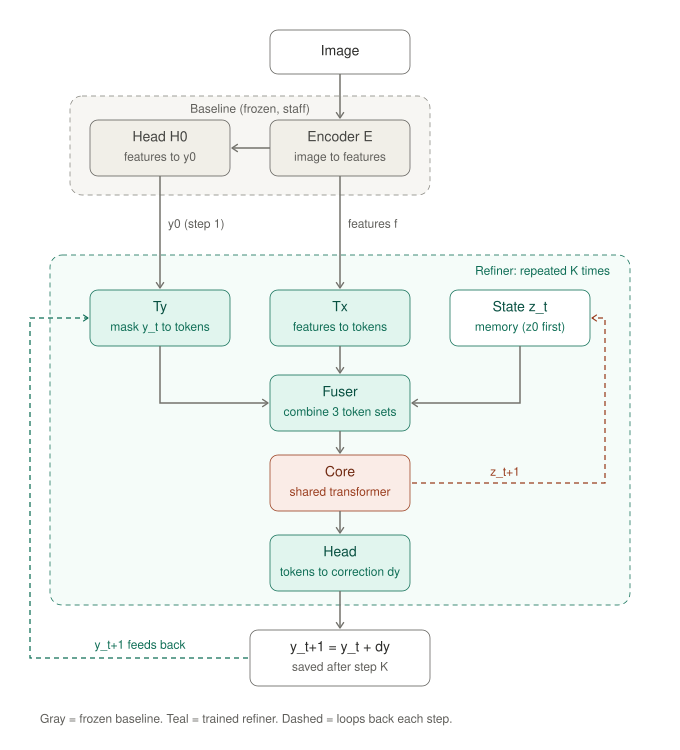
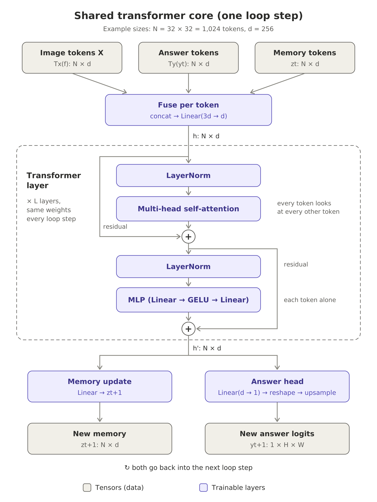

# BU Deep Learning Project #1

# Diagrams




## SCC access (reusable Duo session, no stored password)
SCC asks for password + Duo on every *new* connection (an SSH key alone is not enough,
at least off campus). The config below lets one approved login be reused for 4 hours.

Add to `~/.ssh/config`:
```
Host scc
    HostName scc1.bu.edu
    User <BU_USER>
    IdentityFile ~/.ssh/id_ed25519
    ControlMaster auto
    ControlPath ~/.ssh/cm-%r@%h:%p
    ControlPersist 4h
```
Then, in a separate terminal, open the shared session and leave it running:
```
ssh -N scc        # enter password + approve Duo once
```
While it's open (and for up to 4h after), `ssh scc`, `rsync scc:...` and
`scripts/fetch_data_slice.sh` reuse it with no prompts. If they fail with
`Permission denied (keyboard-interactive,hostbased)`, the session has expired; rerun `ssh -N scc`.

An SSH key (`ssh-copy-id`) did not remove the password/Duo prompt off campus in our testing,
so it's optional.

## Team folder on SCC
`/projectnb/ec523kb/projects/CowenZeollaZinTan/`

Private to the team via ACLs: `fdzeolla`, `samc`, `tant1` read/write; course staff
(`ec523kbta` group, `wd2119`) read-only; rest of the class has no access. New files inherit
these rules (check with `getfacl <path>`).
```
CowenZeollaZinTan/
├── code/
│   ├── fdzeolla/deep_learning_bu_project   # each member's own clone of this repo
│   ├── samc/
│   └── tant1/
├── cache/        # precomputed encoder outputs (f, y0) — shared, large
├── checkpoints/  # trained weights; name by commit + seed
└── runs/         # logs, metrics, prediction samples
```
- **One clone per person** under `code/<BU_USER>/`; only edit your own. A shared clone means
  colliding edits/branches and git "dubious ownership" errors across users.
  ```
  mkdir -p /projectnb/ec523kb/projects/CowenZeollaZinTan/code/$USER && cd $_
  git clone https://github.com/TeckZin/deep_learning_bu_project.git
  ```
- Simplest workflow: write code locally, `git push`, then `git pull` on SCC before running jobs.
  Pushing *from* SCC needs a GitHub SSH key generated on SCC (or a token).
- Read the dataset in place (see Data below); don't copy it into the team folder.
- Copying files in: use `rsync -rlt` or plain `cp` (not `rsync -a` / `cp -p`), so files keep the
  team permissions.
- Run training as batch jobs (`qsub`), not on the login node.

## Data
Dataset (LoveDA layout, 6.1 GB, 4191 tiles) lives on SCC — train there, read it in place:
`/projectnb/ec523kb/projects/RoadSeg/dataset/{Train,Val}/{Urban,Rural}/{images_png,masks_png}`
- Train: 1156 urban + 1366 rural; Val: 677 urban + 992 rural. No test split (staff hold evaluation labels).
- Starter loader: `/projectnb/ec523kb/projects/RoadSeg/code/dataset.py` (7-class; we binarize: 3 = road, 0 = ignore).
- Don't copy data into your SCC home (10 GB quota); use `/projectnb`.

### Local dev slice
For debugging the loop, metrics and visualizations on a laptop, pull a small slice
(requires the `scc` SSH alias above):
```
scripts/fetch_data_slice.sh            # 25 Urban + 25 Rural Val tiles (~70 MB)
scripts/fetch_data_slice.sh 10 Train   # 10 + 10 Train tiles
```
Args: `[N per domain=25] [SPLIT=Val|Train] [HOST=scc]`. It takes the first N tiles
by sorted filename, so everyone running the same command gets the same files.
Output goes to `project_a/data/<SPLIT>/{Urban,Rural}/{images_png,masks_png}/` (gitignored).

**Current shared local slices (Francesco)** — run both so local results are comparable:

| Command | Slice | Size | Use it for |
|---|---|---|---|
| `scripts/fetch_data_slice.sh 10 Train` | first 10 Urban + 10 Rural **Train** tiles (40 files) | 29 MB | Overfit tests and training-loop debugging (gradients, ignore mask, feedback) |
| `scripts/fetch_data_slice.sh` | first 25 Urban + 25 Rural **Val** tiles (100 files) | 69 MB | Evaluation only: metrics, K sweeps, baseline comparison, visualizing masks |

## Environment
`pip install -r requirements_mac.txt` (or `requirements_scc.txt`, which pulls in `project_a/cli/requirements.txt`).

## Working on SCC

All commands below run **on SCC** unless marked "on your Mac". Replace `<BU_USER>` with your BU login.

### 1. Where things live
| What | Path |
|---|---|
| Dataset (read in place, never copy) | `/projectnb/ec523kb/projects/RoadSeg/dataset/{Train,Val}/{Urban,Rural}/{images_png,masks_png}` |
| Your workspace (code, env, outputs) | `/projectnb/ec523kb/students/<BU_USER>/` |
| This repo on SCC | `/projectnb/ec523kb/students/<BU_USER>/deep_learning_bu_project` |
| CLI scripts | `.../deep_learning_bu_project/project_a/cli` |

Your SCC home has a 10 GB quota, so keep the repo, conda env and outputs under `/projectnb/ec523kb/students/<BU_USER>/`.

### 2. Get the code (first time: clone)
```bash
ssh scc
cd /projectnb/ec523kb/students/<BU_USER>
git clone https://github.com/TeckZin/deep_learning_bu_project.git
cd deep_learning_bu_project
git config user.name "<GitHub name>"        # this repo only, no --global
git config user.email "<GitHub email>"
```
Pushing over HTTPS needs a GitHub **personal access token** as the password
(GitHub → Settings → Developer settings → Personal access tokens), or switch to SSH:
`git remote set-url origin git@github.com:TeckZin/deep_learning_bu_project.git` after adding an SCC SSH key to GitHub.

### 3. Update the code (every session: pull)
```bash
cd /projectnb/ec523kb/students/<BU_USER>/deep_learning_bu_project
git pull                       # if it complains about local edits: git stash && git pull
```
To send SCC edits back: `git status`, `git add <files>`, `git commit -m "..."`, `git push`.
Always `git pull` before editing, on both Mac and SCC.

### 4. Python environment (once)
```bash
module load miniconda          # `module avail miniconda` if the name differs
conda create -n dl_env python=3.12 -y
conda activate dl_env
pip install -r requirements_scc.txt pytest
```
Every new shell (including after `qrsh`): `module load miniconda && conda activate dl_env`.
Check you are in the env: `which python` should contain `dl_env`.

### 5. Get a GPU and check it
Login nodes (`scc1`) have no GPU. Get an interactive GPU shell for testing:
```bash
qrsh -P ec523kb -l gpus=1 -l gpu_c=7.0 -l h_rt=01:00:00
module load miniconda && conda activate dl_env
cd /projectnb/ec523kb/students/<BU_USER>/deep_learning_bu_project/project_a/cli
nvidia-smi                                                        # GPU model + memory
python -c "import torch; print(torch.cuda.is_available(), torch.cuda.get_device_name(0))"
```
The second line should print `True` and the GPU name. Type `exit` to give the GPU back.

### 6. Run the tests
From `project_a/cli`:
```bash
python -m pytest tests/ -v                     # expect 27 passed
rm -rf smoke_outputs && python smoke_test.py --output smoke_outputs
```

### 7. Test-train on a small slice
Until staff release the trained baseline, `--demo-baseline` trains on real data with the untrained demo baseline. This only checks the pipeline; the weights are throwaway.
```bash
python train.py --data-root /projectnb/ec523kb/projects/RoadSeg/dataset/Train \
  --demo-baseline --max-images 100 --epochs 1 --steps 2 \
  --output weights/test.safetensors --device cuda
```
Expected: `Rural: 1366 images`, `Urban: 1156 images`, `100 training images`, an epoch loss, `Saved ...`.

Useful `train.py` options: `--fraction 0.1` (random 10% of images), `--max-images N`, `--steps K`, `--epochs`, `--batch-size`, `--lr`, `--seed` (same seed = same subset). Real runs use `--baseline <path>` instead of `--demo-baseline`.

### 8. Evaluate locally on Val
Official manifests come from staff; `make_manifest.py` builds a local one from Val so you can score runs now.
```bash
python make_manifest.py --data-root /projectnb/ec523kb/projects/RoadSeg/dataset/Val \
  --output val_small --max-per-domain 50          # drop --max-per-domain for the full Val set

python predict.py --demo --checkpoint weights/test.safetensors \
  --input val_small/images --output predictions/val_k2 --steps 2 --device cuda
python evaluate.py --manifest val_small/manifest.json \
  --predictions predictions/val_k2 --output reports/val_k2.json
```
Drop `--demo` and add `--baseline <path>` once the real baseline exists. The leaderboard combines K = 1, 2, 4 plus a stress run at K = 4 via `score.py` (`make_stress.py --manifest ...` builds the stress set). `--output` folders must be new or empty.

### 9. Full training as a batch job
Edit paths in `project_a/cli/train_job.sh` (repo path, `--baseline`, options), then:
```bash
mkdir -p logs
qsub train_job.sh              # submit
qstat -u <BU_USER>             # status: qw = waiting, r = running
tail -f logs/train_*.log       # watch output (Ctrl+C to stop watching)
qdel <JOB_ID>                  # cancel a job
```
The checkpoint is saved after every epoch, so a killed job still leaves the latest weights.

### 10. Package the submission
From `project_a/cli` (adjust the checkpoint path to the nominated one):
```bash
zip -r ~/project_a_submission.zip \
  predict.py baseline.py common.py requirements.txt README.md \
  submission/ weights/refiner.safetensors \
  -x "*/__pycache__/*" "*.pyc"
unzip -l ~/project_a_submission.zip            # check: no data, predictions, demo or extra checkpoints
```
Clean-room test (what the TAs recommend):
```bash
rm -rf ~/zip_test && mkdir ~/zip_test && cd ~/zip_test
unzip ~/project_a_submission.zip
python predict.py --checkpoint weights/refiner.safetensors --baseline <baseline> \
  --input /projectnb/ec523kb/students/<BU_USER>/deep_learning_bu_project/project_a/cli/val_small/images \
  --output test_out --steps 4 --device cuda
```
Copy it to your Mac — **run this on your Mac**, not on SCC (prompt must not show `[<BU_USER>@scc-...]`):
```bash
scp scc:~/project_a_submission.zip ~/Downloads/
```
Then upload `~/Downloads/project_a_submission.zip` to the Project A assignment on Gradescope. Check the Gradescope page and handout for any required zip name or layout.

### SCC quick reference
| Task | Command |
|---|---|
| Connect | `ssh scc` |
| Interactive GPU (1 h) | `qrsh -P ec523kb -l gpus=1 -l gpu_c=7.0 -l h_rt=01:00:00` |
| Activate env | `module load miniconda && conda activate dl_env` |
| Check GPU | `nvidia-smi` |
| Submit / status / cancel job | `qsub train_job.sh` / `qstat -u <BU_USER>` / `qdel <JOB_ID>` |
| Disk usage in your folder | `du -sh /projectnb/ec523kb/students/<BU_USER>` |
| Copy SCC → Mac (on Mac) | `scp scc:<path> ~/Downloads/` |

## Docs and readings
- Project handout: `project_a/handout/project_a.pdf`
- Sep 28 pitch slides: `docs/Sep28_Project_Pitch.pdf`
- Attention design options (self vs. concat vs. cross-attention, shapes, cost): `docs/attention_design.md`

Core papers (handout §12):
- Universal Transformers (Dehghani et al., ICLR 2019) — https://arxiv.org/abs/1807.03819
- Less is More: Recursive Reasoning with Tiny Networks (TRM, Jolicoeur-Martineau, 2025) — https://arxiv.org/abs/2510.04871
- Recurrent Scene Parsing with Perspective Understanding in the Loop (Kong & Fowlkes, CVPR 2018) — https://arxiv.org/abs/1705.07238

Metrics and data:
- clDice (Shit et al., CVPR 2021) — https://arxiv.org/abs/2003.07311
- Boundary IoU (Cheng et al., CVPR 2021) — https://arxiv.org/abs/2103.16562
- LoveDA dataset (Wang et al., NeurIPS 2021 D&B) — https://arxiv.org/abs/2110.08733

# EC523 Project A — Team To-Do List

## Setup & Unblocking
- [ ] Ask staff: release of trained baseline + data package, feature contract (C, grid stride), tile policy, final resource caps, GPU access
- [ ] Set up Python 3.12 env, install `cli/requirements.txt`
- [ ] Run `python -m unittest discover -s tests -v` and `python smoke_test.py --output smoke_outputs`
- [ ] Every member reads and can explain the example `submission/model.py`
- [ ] Read the three papers: Universal Transformers, TRM (Less is More), Recurrent Scene Parsing
- [ ] Start a contribution log; assign a primary owner + reviewer for each major piece

## Data & Baseline
- [ ] Download the official course data package; verify checksums and split manifests
- [ ] Verify raw labels (3 = road, 0 = ignore, 1/2/4–7 = non-road); no double remapping
- [ ] Keep all crops from a tile in that tile's split
- [ ] Load the frozen staff baseline; confirm weights + normalization stats stay frozen
- [ ] Reproduce the baseline (K = 0) on development data
- [ ] Save examples of baseline successes and failures

## Model (`submission/model.py`)
- [ ] `build_refiner(feature_channels)` — build all modules once; expose shared transformer as `model.core`
- [ ] Tx: features → image tokens (read C and grid size at run time, LayerNorm, position embeddings)
- [ ] Ty: logits → answer tokens on the same grid as Tx
- [ ] Shared transformer core (≤ 5M params; ≤ 10M total trainable)
- [ ] Output head: tokens → `[B,1,H,W]` logits (upsampling + detail recovery convs allowed)
- [ ] `initialize(f, y0)` → z0, with no core call
- [ ] `step(f, z, y)` → (z_next, y_next), exactly one core call, no labels or total K
- [ ] No independent CNN/U-Net segmentation bypass
- [ ] Passes `predict.py` checks at K = 0 through 8
- [ ] Prefix consistency: steps 0–2 of a K = 4 run match a K = 2 run
- [ ] Export weights to `submission/model.safetensors`

## Training Pipeline
- [ ] Crop-based data loader (no full-resolution global attention)
- [ ] Run frozen baseline to get f and y0 (optionally cache features)
- [ ] Unroll K steps; BCE on logits with ignore mask; skip all-ignore crops
- [ ] Intermediate supervision with weights w_t (sum to 1)
- [ ] Train with mixed K so one checkpoint works at every K
- [ ] Mixed precision / grad accumulation / activation checkpointing as needed
- [ ] Overfit a tiny subset first to verify gradients, ignore mask, and feedback
- [ ] Log peak training memory (target ≤ 32 GiB) and GPU-hours
- [ ] Select checkpoints on development data only — never evaluation labels

## Evaluation
- [ ] Run `evaluate.py` on dev data for every K
- [ ] Generate stress set with `make_stress.py`; evaluate at K = 4
- [ ] Compute the four-component leaderboard score with `score.py`
- [ ] Report urban / rural and per-corruption breakdowns
- [ ] Measure latency, inference memory, parameter counts (core vs total)

## Required Experiments
- [ ] **1. Iteration curve:** baseline + same checkpoint at K = 1, 2, 4, 6, 8; plot each metric vs K and vs time; state which K were trained
- [ ] **2. State/feedback interventions:** `--ablation reset-state` and `--ablation no-mask-feedback`; plus a retrained no-feedback control for strong claims
- [ ] **3. Non-recurrent control:** one-step model at matched parameters; untied stack at matched compute if feasible; report mismatches
- [ ] **4. Design ablation:** one hypothesis-driven change, with predicted outcome written before running
- [ ] **5. Failures & uncertainty:** unselected successes/failures (false connections, vanishing roads, later-step degradation); 3 seeds or paired bootstrap intervals

## Potential Experiment Ideas
Candidates for the design ablation (#4) or extra analysis. Write the predicted outcome before running.
- [ ] **Strong vs. weak encoder:** run the K-sweep and state/feedback ablations on two frozen encoders (e.g. a large pretrained backbone and a smaller/weaker one), each with its own y0.
  Hypotheses: "refinement helps more when the initial mask is worse"; "refinement mainly helps thin and occluded roads" (check with per-road-width and stress-family breakdowns).
- [ ] **Relative vs. absolute position encoding in the core:** 2D RoPE or a Swin-style relative position bias (re-applied in every attention call, so every loop step) vs. absolute 2D embeddings / coordinate channels added once.
  Hypothesis: relative encoding transfers better from 512 crops (32×32 tokens) to full 1024 tiles (64×64 tokens) and keeps position from washing out of z over K steps.
  Note: the demo's coordinate channels span [-1, 1] over whatever input it gets, so their scale differs between crops and full tiles.
- [ ] **Local (window) vs. global attention:** test whether long-range context is what closes gaps and removes false bridges.

## Final Submission
- [ ] One nominated checkpoint + source code
- [ ] Pinned environment and training instructions
- [ ] Run manifest linking results to seeds and checkpoints
- [ ] Fresh offline environment runs the exact `predict.py` command at all K, no downloads, no labels
- [ ] Method diagram and parameter table
- [ ] K-sweep plots and latency/memory measurements
- [ ] All required controls and representative intermediate masks + failures

## Report & Presentation
- [ ] Specific, falsifiable research claim
- [ ] Method, fair controls, ablations, uncertainty, error analysis, limitations
- [ ] Report written by the team (AI only for grammar); course template and page limit
- [ ] Citations for code, data, figures, ideas; AI/code-use disclosure
- [ ] Contribution statement
- [ ] Slides in course template (no AI for the presentation)
- [ ] Every member can explain one update, state vs parameters, tensor shapes, and what state-reset / feedback removal should change
