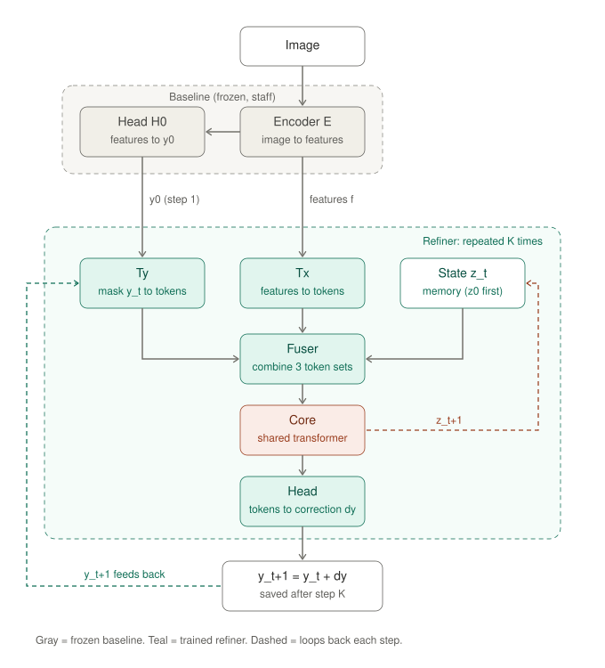
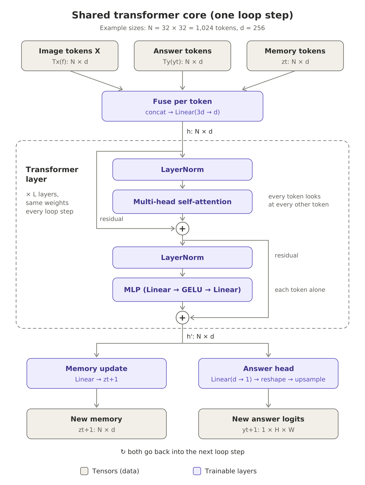

# BU Deep Learning Project #1

# Diagrams




## SCC access (key-based, no stored password)
One-time setup, run in your own terminal (needs password + Duo once):
```
ssh-copy-id -i ~/.ssh/id_ed25519.pub <BU_USER>@scc1.bu.edu
```
Add to `~/.ssh/config`:
```
Host scc
    HostName scc1.bu.edu
    User <BU_USER>
    IdentityFile ~/.ssh/id_ed25519
    ControlMaster auto
    ControlPath ~/.ssh/cm-%r@%h:%p
    ControlPersist 4h
```
Then `ssh scc` and `rsync scc:...` work without a password.

## Data
Dataset (LoveDA layout, 6.1 GB, 4191 tiles) lives on SCC — train there, read it in place:
`/projectnb/ec523kb/projects/RoadSeg/dataset/{Train,Val}/{Urban,Rural}/{images_png,masks_png}`
- Train: 1156 urban + 1366 rural; Val: 677 urban + 992 rural. No test split (staff hold evaluation labels).
- Starter loader: `/projectnb/ec523kb/projects/RoadSeg/code/dataset.py` (7-class; we binarize: 3 = road, 0 = ignore).
- Don't copy data into your SCC home (10 GB quota); use `/projectnb`.

### Local dev slice
For debugging the loop, metrics and visualizations on a laptop, pull a small slice
(requires the `scc` SSH alias above):
```
scripts/fetch_data_slice.sh            # 25 Urban + 25 Rural Val tiles (~70 MB)
scripts/fetch_data_slice.sh 10 Train   # 10 + 10 Train tiles
```
Args: `[N per domain=25] [SPLIT=Val|Train] [HOST=scc]`. It takes the first N tiles
by sorted filename, so everyone running the same command gets the same files.
Output goes to `project_a/data/<SPLIT>/{Urban,Rural}/{images_png,masks_png}/` (gitignored).

**Current shared local slices (Francesco)** — run both so local results are comparable:

| Command | Slice | Size | Use it for |
|---|---|---|---|
| `scripts/fetch_data_slice.sh 10 Train` | first 10 Urban + 10 Rural **Train** tiles (40 files) | 29 MB | Overfit tests and training-loop debugging (gradients, ignore mask, feedback) |
| `scripts/fetch_data_slice.sh` | first 25 Urban + 25 Rural **Val** tiles (100 files) | 69 MB | Evaluation only: metrics, K sweeps, baseline comparison, visualizing masks |

## Environment
`pip install -r project_a/cli/requirements.txt` (Python 3.12). On a Mac whose default Python is newer:
`cd project_a/cli && uv venv --python 3.12 .venv && uv pip install --python .venv/bin/python -r requirements.txt`.
On SCC, use the shared environment (section 4 below).

## Working on SCC

All commands below run **on SCC** unless marked "on your Mac". Replace `<BU_USER>` with your BU login.

### 1. Where things live
| What | Path |
|---|---|
| Dataset (read in place, never copy) | `/projectnb/ec523kb/projects/RoadSeg/dataset/{Train,Val}/{Urban,Rural}/{images_png,masks_png}` |
| Team space (code, env, outputs) | `/projectnb/ec523kb/projects/CowenZeollaZinTan/` (layout: [`docs/SCC.md`](docs/SCC.md)) |
| Your clone on SCC | `/projectnb/ec523kb/projects/CowenZeollaZinTan/code/<BU_USER>/deep_learning_bu_project` |
| CLI scripts | `.../deep_learning_bu_project/project_a/cli` |

Your SCC home has a 10 GB quota, so keep code, env and outputs in the team space. Each member has their own clone; checkpoints and logs go to the shared `runs/` folder (see [`docs/SCC.md`](docs/SCC.md)).

### 2. Get the code (first time: clone)
```bash
ssh scc
mkdir -p /projectnb/ec523kb/projects/CowenZeollaZinTan/code/<BU_USER> && cd /projectnb/ec523kb/projects/CowenZeollaZinTan/code/<BU_USER>
git clone https://github.com/TeckZin/deep_learning_bu_project.git
cd deep_learning_bu_project
ln -s /projectnb/ec523kb/projects/CowenZeollaZinTan/runs      project_a/cli/weights   # outputs go to the shared runs/ folder
ln -s /projectnb/ec523kb/projects/CowenZeollaZinTan/runs/logs project_a/cli/logs
git config user.name "<GitHub name>"        # this repo only, no --global
git config user.email "<GitHub email>"
```
Pushing over HTTPS needs a GitHub **personal access token** as the password
(GitHub → Settings → Developer settings → Personal access tokens), or switch to SSH:
`git remote set-url origin git@github.com:TeckZin/deep_learning_bu_project.git` after adding an SCC SSH key to GitHub.

### 3. Update the code (every session: pull)
```bash
cd /projectnb/ec523kb/projects/CowenZeollaZinTan/code/<BU_USER>/deep_learning_bu_project
git pull                       # if it complains about local edits: git stash && git pull
```
To send SCC edits back: `git status`, `git add <files>`, `git commit -m "..."`, `git push`.
Always `git pull` before editing, on both Mac and SCC.

### 4. Python environment (shared, created once for the team)
Everyone uses `/projectnb/ec523kb/projects/CowenZeollaZinTan/envs/dl_env`. Only if it does not exist yet (one member, once):
```bash
module load miniconda
conda create -p /projectnb/ec523kb/projects/CowenZeollaZinTan/envs/dl_env python=3.12 -y
conda activate /projectnb/ec523kb/projects/CowenZeollaZinTan/envs/dl_env
pip install -r project_a/cli/requirements.txt
```
Every new shell (including after `qrsh`): `module load miniconda && conda activate /projectnb/ec523kb/projects/CowenZeollaZinTan/envs/dl_env`.
Check: `which python` should contain `envs/dl_env`. Batch jobs activate it themselves (`jobs/common.sh`).
DINOv2 weights are cached for everyone in `/projectnb/ec523kb/projects/CowenZeollaZinTan/cache/torch`; download once on a login node:
`TORCH_HOME=/projectnb/ec523kb/projects/CowenZeollaZinTan/cache/torch python -c "import torch; torch.hub.load('facebookresearch/dinov2', 'dinov2_vits14', trust_repo=True)"`.

### 5. Get a GPU and check it
Login nodes (`scc1`) have no GPU. Get an interactive GPU shell for testing:
```bash
qrsh -P ec523kb -l gpus=1 -l gpu_c=7.0 -l h_rt=01:00:00
module load miniconda && conda activate /projectnb/ec523kb/projects/CowenZeollaZinTan/envs/dl_env
cd /projectnb/ec523kb/projects/CowenZeollaZinTan/code/<BU_USER>/deep_learning_bu_project/project_a/cli
nvidia-smi                                                        # GPU model + memory
python -c "import torch; print(torch.cuda.is_available(), torch.cuda.get_device_name(0))"
```
The second line should print `True` and the GPU name. Type `exit` to give the GPU back.

### 6. Run the tests
From `project_a/cli` (locally: `uv venv --python 3.12 .venv && uv pip install --python .venv/bin/python -r requirements.txt`):
```bash
python -m unittest discover -s tests -v        # staff tests + ours (tests/test_project.py)
rm -rf smoke_outputs && python smoke_test.py --output smoke_outputs
```

### 7. How the code is organised
**Start with [`docs/CodeStructure.md`](docs/CodeStructure.md)**: diagrams, entry points and a file map. To change a stage: [`docs/ChangingTheArchitecture.md`](docs/ChangingTheArchitecture.md). Design decisions: `docs/ModularRefactorPlan.md`. In short (all in `project_a/cli`):

| Stage | File |
|---|---|
| Data, augmentation, crops | `data.py` |
| CV folds; which data trains H0 vs the refiner | `splits.py` → `splits/folds.csv` (committed) |
| Frozen encoder (DINOv2) + H0 head → `(f, y0)` | `frozen_encoder.py`, trained by `train_h0.py` |
| Refiner (shipped): tokenizer, state, core, head | `submission/` (`config.py` holds the architecture presets) |
| Losses / evaluation | `losses.py` / `evaluation.py` |
| Training recipes | `experiments/<name>.json` |
| Leaderboard inference / zip | `infer.py` / `export_submission.py` |

### 8. Cross-validation folds (once for the team)
Train + Val are pooled into 5 folds stratified by urban/rural (the leaderboard is the test set):
```bash
export ROADSEG_DATA=/projectnb/ec523kb/projects/RoadSeg/dataset
python splits.py make                       # writes splits/folds.csv -> commit it
python splits.py manifest --fold 0 --out val_fold0 --stress    # optional: manifest + stress copy for predict.py / evaluate.py
```

### 9. Training (batch jobs)
A run validates on one fold and trains on the other four. H0 heads come first (out-of-fold by
default: the refiner's y0 always comes from an H0 that never saw that image), then the refiner:
```bash
mkdir -p logs
bash jobs/cv.sh attempt8 0               # fold 0: H0 job, then refiner job (held until H0 finishes)
bash jobs/cv.sh attempt8 "0 1 2 3 4"     # all five folds
qstat -u <BU_USER>                       # status: qw = waiting, r = running
tail -F logs/attempt8_f0.*.log
```
- New experiment: copy `experiments/attempt8.json`, change it, give it a new `"run"` name.
  Jobs write to `weights/<BU_USER>-<run>/fold<F>/` (= the shared `runs/`), so members never share a run folder.
  Per-fold settings go in `"fold_overrides": {"2": {"lr": 1e-4}}`.
- Architecture: `"arch"` picks a preset in `submission/config.py`; ablations without a new preset:
  `bash jobs/cv.sh attempt8 0 --set core.layers=6 --run <BU_USER>-attempt8-l6`.
- Halves instead of out-of-fold: `"h0_scheme": "halves"`.
- Outputs: `weights/<BU_USER>-<run>/fold<F>/refiner_best.safetensors` (+ `run.json` with every setting and the git commit).
  Re-submitting continues a killed job from its last epoch; `train.py` refuses to reuse a run folder with different settings.
- Quick check on an interactive GPU: `python train.py --config experiments/attempt8.json --val-fold 0 --max-images 50 --val-max-images 20 --epochs 1`.

### 10. Package the submission
```bash
python export_submission.py --refiner weights/<BU_USER>-attempt8/fold0/refiner_best.safetensors \
  --out dist/submission --zip --check val_fold0/images
unzip -l dist/submission.zip                     # infer.py, frozen_encoder.py, submission/, ONE weights file
```
`--check` unpacks into an empty folder and runs `infer.py` there, like a teammate starting from the zip.
The leaderboard runs `python infer.py --input IMAGES --output OUT`, which writes `OUT/k<K>/<id>.png`
(1 = road, 0 = non-road) for K = 0, 1, 2, 4, 6, 8. Before submitting, set `ACTIVE` in
`submission/config.py` to the submitted preset so the staff `predict.py` builds the same model.
Copy it to your Mac — **run this on your Mac**, not on SCC:
```bash
scp scc:/projectnb/ec523kb/projects/CowenZeollaZinTan/code/<BU_USER>/deep_learning_bu_project/project_a/cli/dist/submission.zip ~/Downloads/
```

### SCC quick reference
| Task | Command |
|---|---|
| Connect | `ssh scc` |
| Interactive GPU (1 h) | `qrsh -P ec523kb -l gpus=1 -l gpu_c=7.0 -l h_rt=01:00:00` |
| Activate env | `module load miniconda && conda activate /projectnb/ec523kb/projects/CowenZeollaZinTan/envs/dl_env` |
| Check GPU | `nvidia-smi` |
| Submit / status / cancel job | `bash jobs/cv.sh <exp> 0` / `qstat -u <BU_USER>` / `qdel <JOB_ID>` |
| Disk usage of the team space | `du -sh /projectnb/ec523kb/projects/CowenZeollaZinTan/*` |
| Copy SCC → Mac (on Mac) | `scp scc:<path> ~/Downloads/` |

## Docs and readings
- Project handout: `project_a/handout/project_a.pdf`
- Sep 28 pitch slides: `docs/Sep28_Project_Pitch.pdf`

Core papers (handout §12):
- Universal Transformers (Dehghani et al., ICLR 2019) — https://arxiv.org/abs/1807.03819
- Less is More: Recursive Reasoning with Tiny Networks (TRM, Jolicoeur-Martineau, 2025) — https://arxiv.org/abs/2510.04871
- Recurrent Scene Parsing with Perspective Understanding in the Loop (Kong & Fowlkes, CVPR 2018) — https://arxiv.org/abs/1705.07238

Metrics and data:
- clDice (Shit et al., CVPR 2021) — https://arxiv.org/abs/2003.07311
- Boundary IoU (Cheng et al., CVPR 2021) — https://arxiv.org/abs/2103.16562
- LoveDA dataset (Wang et al., NeurIPS 2021 D&B) — https://arxiv.org/abs/2110.08733

# EC523 Project A — Team To-Do List

## Setup & Unblocking
- [ ] Ask staff: release of trained baseline + data package, feature contract (C, grid stride), tile policy, final resource caps, GPU access
- [ ] Set up Python 3.12 env, install `cli/requirements.txt`
- [ ] Run `python -m unittest discover -s tests -v` and `python smoke_test.py --output smoke_outputs`
- [ ] Every member reads and can explain the example `submission/model.py`
- [ ] Read the three papers: Universal Transformers, TRM (Less is More), Recurrent Scene Parsing
- [ ] Start a contribution log; assign a primary owner + reviewer for each major piece

## Data & Baseline
- [ ] Download the official course data package; verify checksums and split manifests
- [ ] Verify raw labels (3 = road, 0 = ignore, 1/2/4–7 = non-road); no double remapping
- [ ] Keep all crops from a tile in that tile's split
- [ ] Load the frozen staff baseline; confirm weights + normalization stats stay frozen
- [ ] Reproduce the baseline (K = 0) on development data
- [ ] Save examples of baseline successes and failures

## Model (`submission/model.py`)
- [ ] `build_refiner(feature_channels)` — build all modules once; expose shared transformer as `model.core`
- [ ] Tx: features → image tokens (read C and grid size at run time, LayerNorm, position embeddings)
- [ ] Ty: logits → answer tokens on the same grid as Tx
- [ ] Shared transformer core (≤ 5M params; ≤ 10M total trainable)
- [ ] Output head: tokens → `[B,1,H,W]` logits (upsampling + detail recovery convs allowed)
- [ ] `initialize(f, y0)` → z0, with no core call
- [ ] `step(f, z, y)` → (z_next, y_next), exactly one core call, no labels or total K
- [ ] No independent CNN/U-Net segmentation bypass
- [ ] Image used only inside the loop (in `step()`), never on the final prediction after step K (TA, 2026-11-18)
- [ ] Passes `predict.py` checks at K = 0 through 8
- [ ] Prefix consistency: steps 0–2 of a K = 4 run match a K = 2 run
- [ ] Export weights to `submission/model.safetensors`

## Training Pipeline
- [ ] Crop-based data loader (no full-resolution global attention)
- [ ] Run frozen baseline to get f and y0 (optionally cache features)
- [ ] Unroll K steps; BCE on logits with ignore mask; skip all-ignore crops
- [ ] Intermediate supervision with weights w_t (sum to 1)
- [ ] Train with mixed K so one checkpoint works at every K
- [ ] Mixed precision / grad accumulation / activation checkpointing as needed
- [ ] Overfit a tiny subset first to verify gradients, ignore mask, and feedback
- [ ] Log peak training memory (target ≤ 32 GiB) and GPU-hours
- [ ] Select checkpoints on development data only — never evaluation labels

## Evaluation
- [ ] Run `evaluate.py` on dev data for every K
- [ ] Generate stress set with `make_stress.py`; evaluate at K = 4
- [ ] Compute the four-component leaderboard score with `score.py`
- [ ] Report urban / rural and per-corruption breakdowns
- [ ] Measure latency, inference memory, parameter counts (core vs total)

## Required Experiments
- [ ] **1. Iteration curve:** baseline + same checkpoint at K = 1, 2, 4, 6, 8; plot each metric vs K and vs time; state which K were trained
- [ ] **2. State/feedback interventions:** `--ablation reset-state` and `--ablation no-mask-feedback`; plus a retrained no-feedback control for strong claims
- [ ] **3. Non-recurrent control:** one-step model at matched parameters; untied stack at matched compute if feasible; report mismatches
- [ ] **4. Design ablation:** one hypothesis-driven change, with predicted outcome written before running
- [ ] **5. Failures & uncertainty:** unselected successes/failures (false connections, vanishing roads, later-step degradation); 3 seeds or paired bootstrap intervals

## Potential Experiment Ideas
Candidates for the design ablation (#4) or extra analysis. Write the predicted outcome before running.
- [ ] **Strong vs. weak encoder:** run the K-sweep and state/feedback ablations on two frozen encoders (e.g. a large pretrained backbone and a smaller/weaker one), each with its own y0.
  Hypotheses: "refinement helps more when the initial mask is worse"; "refinement mainly helps thin and occluded roads" (check with per-road-width and stress-family breakdowns).
- [ ] **Relative vs. absolute position encoding in the core:** 2D RoPE or a Swin-style relative position bias (re-applied in every attention call, so every loop step) vs. absolute 2D embeddings / coordinate channels added once.
  Hypothesis: relative encoding transfers better from 512 crops (32×32 tokens) to full 1024 tiles (64×64 tokens) and keeps position from washing out of z over K steps.
  Note: the demo's coordinate channels span [-1, 1] over whatever input it gets, so their scale differs between crops and full tiles.
- [ ] **Local (window) vs. global attention:** test whether long-range context is what closes gaps and removes false bridges.

## Final Submission
- [ ] One nominated checkpoint + source code
- [ ] Pinned environment and training instructions
- [ ] Run manifest linking results to seeds and checkpoints
- [ ] Fresh offline environment runs the exact `predict.py` command at all K, no downloads, no labels
- [ ] Method diagram and parameter table
- [ ] K-sweep plots and latency/memory measurements
- [ ] All required controls and representative intermediate masks + failures

## Report & Presentation
- [ ] Specific, falsifiable research claim
- [ ] Method, fair controls, ablations, uncertainty, error analysis, limitations
- [ ] Report written by the team (AI only for grammar); course template and page limit
- [ ] Citations for code, data, figures, ideas; AI/code-use disclosure
- [ ] Contribution statement
- [ ] Slides in course template (no AI for the presentation)
- [ ] Every member can explain one update, state vs parameters, tensor shapes, and what state-reset / feedback removal should change
