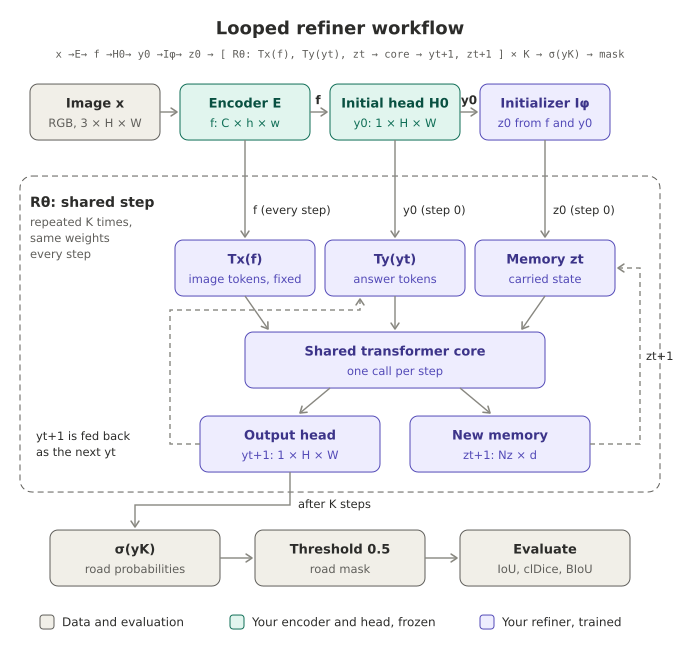
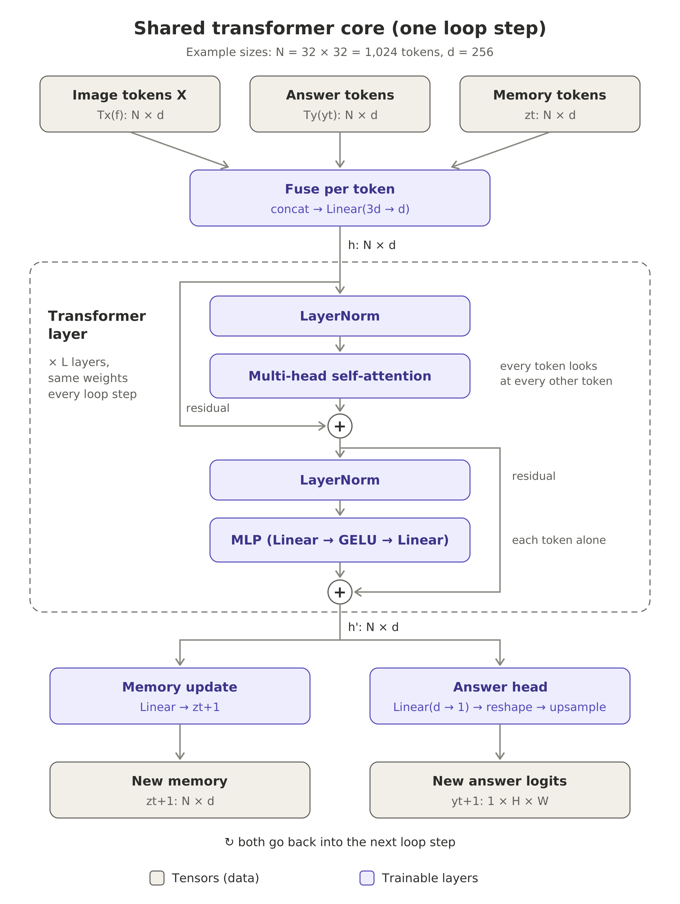

# BU Deep Learning Project #1

# Diagrams




## SCC access (key-based, no stored password)
One-time setup, run in your own terminal (needs password + Duo once):
```
ssh-copy-id -i ~/.ssh/id_ed25519.pub <BU_USER>@scc1.bu.edu
```
Add to `~/.ssh/config`:
```
Host scc
    HostName scc1.bu.edu
    User <BU_USER>
    IdentityFile ~/.ssh/id_ed25519
    ControlMaster auto
    ControlPath ~/.ssh/cm-%r@%h:%p
    ControlPersist 4h
```
Then `ssh scc` and `rsync scc:...` work without a password.

## Data
Dataset (LoveDA layout, 6.1 GB, 4191 tiles) lives on SCC — train there, read it in place:
`/projectnb/ec523kb/projects/RoadSeg/dataset/{Train,Val}/{Urban,Rural}/{images_png,masks_png}`
- Train: 1156 urban + 1366 rural; Val: 677 urban + 992 rural. No test split (staff hold evaluation labels).
- Starter loader: `/projectnb/ec523kb/projects/RoadSeg/code/dataset.py` (7-class; we binarize: 3 = road, 0 = ignore).
- Don't copy data into your SCC home (10 GB quota); use `/projectnb`.

### Local dev slice
For debugging the loop, metrics and visualizations on a laptop, pull a small slice
(requires the `scc` SSH alias above):
```
scripts/fetch_data_slice.sh            # 25 Urban + 25 Rural Val tiles (~70 MB)
scripts/fetch_data_slice.sh 10 Train   # 10 + 10 Train tiles
```
Args: `[N per domain=25] [SPLIT=Val|Train] [HOST=scc]`. It takes the first N tiles
by sorted filename, so everyone running the same command gets the same files.
Output goes to `project_a/data/<SPLIT>/{Urban,Rural}/{images_png,masks_png}/` (gitignored).

**Current shared local slices (Francesco)** — run both so local results are comparable:

| Command | Slice | Size | Use it for |
|---|---|---|---|
| `scripts/fetch_data_slice.sh 10 Train` | first 10 Urban + 10 Rural **Train** tiles (40 files) | 29 MB | Overfit tests and training-loop debugging (gradients, ignore mask, feedback) |
| `scripts/fetch_data_slice.sh` | first 25 Urban + 25 Rural **Val** tiles (100 files) | 69 MB | Evaluation only: metrics, K sweeps, baseline comparison, visualizing masks |

## Environment
`pip install -r requirements_mac.txt` (or `requirements_scc.txt`, which pulls in `project_a/cli/requirements.txt`).

## Docs and readings
- Project handout: `project_a/handout/project_a.pdf`
- Sep 28 pitch slides: `docs/Sep28_Project_Pitch.pdf`

Core papers (handout §12):
- Universal Transformers (Dehghani et al., ICLR 2019) — https://arxiv.org/abs/1807.03819
- Less is More: Recursive Reasoning with Tiny Networks (TRM, Jolicoeur-Martineau, 2025) — https://arxiv.org/abs/2510.04871
- Recurrent Scene Parsing with Perspective Understanding in the Loop (Kong & Fowlkes, CVPR 2018) — https://arxiv.org/abs/1705.07238

Metrics and data:
- clDice (Shit et al., CVPR 2021) — https://arxiv.org/abs/2003.07311
- Boundary IoU (Cheng et al., CVPR 2021) — https://arxiv.org/abs/2103.16562
- LoveDA dataset (Wang et al., NeurIPS 2021 D&B) — https://arxiv.org/abs/2110.08733

# EC523 Project A — Team To-Do List

## Setup & Unblocking
- [ ] Ask staff: release of trained baseline + data package, feature contract (C, grid stride), tile policy, final resource caps, GPU access
- [ ] Set up Python 3.12 env, install `cli/requirements.txt`
- [ ] Run `python -m unittest discover -s tests -v` and `python smoke_test.py --output smoke_outputs`
- [ ] Every member reads and can explain the example `submission/model.py`
- [ ] Read the three papers: Universal Transformers, TRM (Less is More), Recurrent Scene Parsing
- [ ] Start a contribution log; assign a primary owner + reviewer for each major piece

## Data & Baseline
- [ ] Download the official course data package; verify checksums and split manifests
- [ ] Verify raw labels (3 = road, 0 = ignore, 1/2/4–7 = non-road); no double remapping
- [ ] Keep all crops from a tile in that tile's split
- [ ] Load the frozen staff baseline; confirm weights + normalization stats stay frozen
- [ ] Reproduce the baseline (K = 0) on development data
- [ ] Save examples of baseline successes and failures

## Model (`submission/model.py`)
- [ ] `build_refiner(feature_channels)` — build all modules once; expose shared transformer as `model.core`
- [ ] Tx: features → image tokens (read C and grid size at run time, LayerNorm, position embeddings)
- [ ] Ty: logits → answer tokens on the same grid as Tx
- [ ] Shared transformer core (≤ 5M params; ≤ 10M total trainable)
- [ ] Output head: tokens → `[B,1,H,W]` logits (upsampling + detail recovery convs allowed)
- [ ] `initialize(f, y0)` → z0, with no core call
- [ ] `step(f, z, y)` → (z_next, y_next), exactly one core call, no labels or total K
- [ ] No independent CNN/U-Net segmentation bypass
- [ ] Passes `predict.py` checks at K = 0 through 8
- [ ] Prefix consistency: steps 0–2 of a K = 4 run match a K = 2 run
- [ ] Export weights to `submission/model.safetensors`

## Training Pipeline
- [ ] Crop-based data loader (no full-resolution global attention)
- [ ] Run frozen baseline to get f and y0 (optionally cache features)
- [ ] Unroll K steps; BCE on logits with ignore mask; skip all-ignore crops
- [ ] Intermediate supervision with weights w_t (sum to 1)
- [ ] Train with mixed K so one checkpoint works at every K
- [ ] Mixed precision / grad accumulation / activation checkpointing as needed
- [ ] Overfit a tiny subset first to verify gradients, ignore mask, and feedback
- [ ] Log peak training memory (target ≤ 32 GiB) and GPU-hours
- [ ] Select checkpoints on development data only — never evaluation labels

## Evaluation
- [ ] Run `evaluate.py` on dev data for every K
- [ ] Generate stress set with `make_stress.py`; evaluate at K = 4
- [ ] Compute the four-component leaderboard score with `score.py`
- [ ] Report urban / rural and per-corruption breakdowns
- [ ] Measure latency, inference memory, parameter counts (core vs total)

## Required Experiments
- [ ] **1. Iteration curve:** baseline + same checkpoint at K = 1, 2, 4, 6, 8; plot each metric vs K and vs time; state which K were trained
- [ ] **2. State/feedback interventions:** `--ablation reset-state` and `--ablation no-mask-feedback`; plus a retrained no-feedback control for strong claims
- [ ] **3. Non-recurrent control:** one-step model at matched parameters; untied stack at matched compute if feasible; report mismatches
- [ ] **4. Design ablation:** one hypothesis-driven change, with predicted outcome written before running
- [ ] **5. Failures & uncertainty:** unselected successes/failures (false connections, vanishing roads, later-step degradation); 3 seeds or paired bootstrap intervals

## Potential Experiment Ideas
Candidates for the design ablation (#4) or extra analysis. Write the predicted outcome before running.
- [ ] **Strong vs. weak encoder:** run the K-sweep and state/feedback ablations on two frozen encoders (e.g. a large pretrained backbone and a smaller/weaker one), each with its own y0.
  Hypotheses: "refinement helps more when the initial mask is worse"; "refinement mainly helps thin and occluded roads" (check with per-road-width and stress-family breakdowns).
- [ ] **Relative vs. absolute position encoding in the core:** 2D RoPE or a Swin-style relative position bias (re-applied in every attention call, so every loop step) vs. absolute 2D embeddings / coordinate channels added once.
  Hypothesis: relative encoding transfers better from 512 crops (32×32 tokens) to full 1024 tiles (64×64 tokens) and keeps position from washing out of z over K steps.
  Note: the demo's coordinate channels span [-1, 1] over whatever input it gets, so their scale differs between crops and full tiles.
- [ ] **Local (window) vs. global attention:** test whether long-range context is what closes gaps and removes false bridges.

## Final Submission
- [ ] One nominated checkpoint + source code
- [ ] Pinned environment and training instructions
- [ ] Run manifest linking results to seeds and checkpoints
- [ ] Fresh offline environment runs the exact `predict.py` command at all K, no downloads, no labels
- [ ] Method diagram and parameter table
- [ ] K-sweep plots and latency/memory measurements
- [ ] All required controls and representative intermediate masks + failures

## Report & Presentation
- [ ] Specific, falsifiable research claim
- [ ] Method, fair controls, ablations, uncertainty, error analysis, limitations
- [ ] Report written by the team (AI only for grammar); course template and page limit
- [ ] Citations for code, data, figures, ideas; AI/code-use disclosure
- [ ] Contribution statement
- [ ] Slides in course template (no AI for the presentation)
- [ ] Every member can explain one update, state vs parameters, tensor shapes, and what state-reset / feedback removal should change


