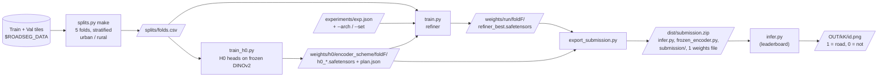
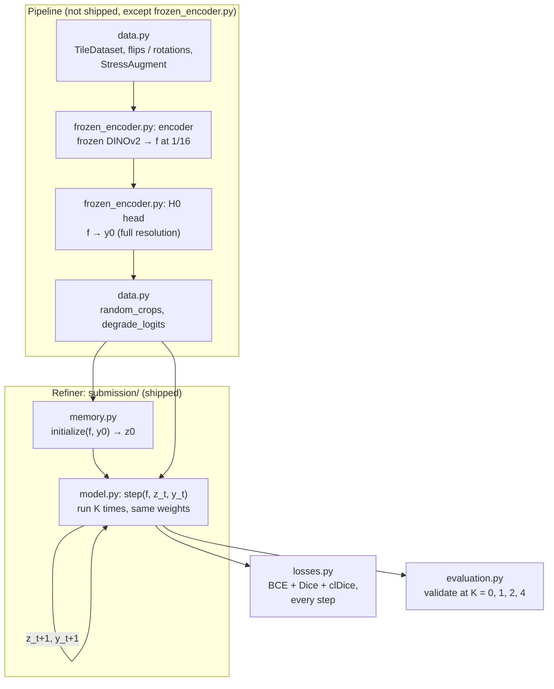
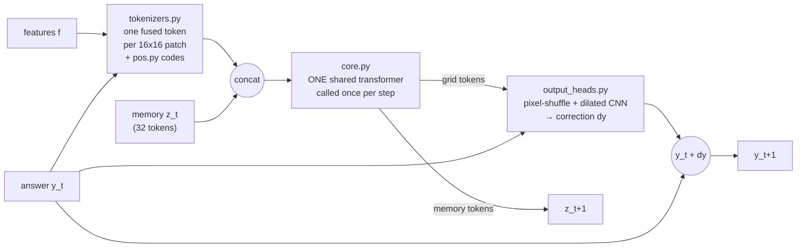
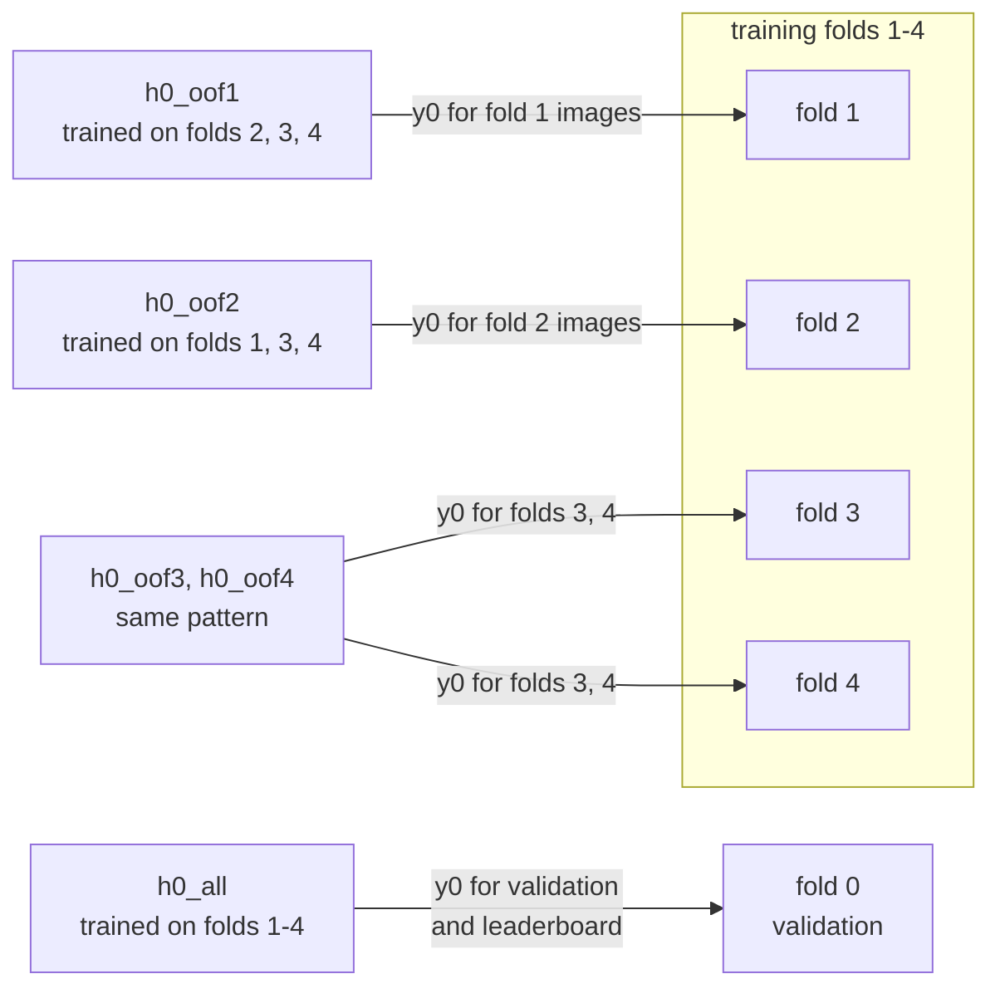

# Code structure (Project A)

Start here. This page shows how the code fits together and which file to run or edit.
Design rationale and decisions: [ModularRefactorPlan.md](ModularRefactorPlan.md).
Pipeline stages it maps to: [ModulesAndDesignDecisions.md](ModulesAndDesignDecisions.md).
Team space on the SCC (shared runs, logs, env, permissions): [SCC.md](SCC.md).
How to change each pipeline stage (file, config knob, rules): [ChangingTheArchitecture.md](ChangingTheArchitecture.md).
All paths are relative to `project_a/cli/`.

## Entry points

| I want to... | Run | Writes |
|---|---|---|
| Make the CV folds (once, team-wide) | `python splits.py make` | `splits/folds.csv` (commit it) |
| Train H0 heads for a fold | `python train_h0.py --val-fold F` | `weights/h0/<encoder>_<scheme>/foldF/h0_*.safetensors`, `plan.json` |
| Train the refiner on a fold | `python train.py --config experiments/<exp>.json --val-fold F` | `weights/<run>/foldF/refiner*.safetensors`, `run.json` (jobs: run = `<login>-<exp>`) |
| Both, as SCC jobs | `bash jobs/cv.sh <exp> [FOLDS]` | same, logs in `logs/` |
| Build the leaderboard zip | `python export_submission.py --refiner CKPT --zip --check IMAGES` | `dist/submission/`, `dist/submission.zip` |
| Run the leaderboard inference | `python infer.py --input IMAGES --output OUT` | `OUT/k<K>/<id>.png`, `OUT_intermediate/` |
| Fold manifest for staff tools | `python splits.py manifest --fold F --out val_foldF --stress` | `val_foldF/`, `val_foldF_stress/` |
| Check everything still works | `python -m unittest discover -s tests` | (35 tests) |
| See presets and their sizes | `python -m submission.model` | (prints) |

`$ROADSEG_DATA` points at the dataset folder (`.../RoadSeg/dataset`, containing `Train/` and `Val/`).

## The whole pipeline



## Inside one run: data → frozen encoder → refiner



## One refinement step (`submission/model.py`)



Every box is chosen by `submission/config.py`: `tokenizer`, `memory`, `core` and `head` sections,
each with a `kind` that picks a class from that file's registry (`TOKENIZERS`, `MEMORIES`, `HEADS`).

## Which H0 gives the refiner its y0 (fold 0 validating)



Default `--h0-scheme oof`: the refiner trains on all four training folds, always with y0 from an
H0 that never saw the image. Option `halves`: H0 (`h0_a`) on half of the training folds, the
refiner on the other half, `h0_a` everywhere.

## File map

```
project_a/cli/
├── submission/               THE REFINER (shipped in the zip; staff predict.py imports it)
│   ├── config.py             architecture presets (PRESETS, ACTIVE), overrides, metadata round trip
│   ├── model.py              Refiner: initialize() / step(); build_refiner(), load_refiner()
│   ├── tokenizers.py         (f, y_t) → grid tokens          doc stages 5, 7, 8
│   ├── memory.py             grid → z0 (memory initialization)   doc stage 6
│   ├── core.py               the shared transformer (model.core)   doc stages 9-11
│   ├── output_heads.py       grid tokens → dy                 doc stages 12-13
│   └── pos.py                2D sin/cos position code
├── frozen_encoder.py         frozen encoder + H0 heads → (f, y0)   doc stages 2, 4 (shipped)
├── infer.py                  leaderboard CLI: encode stage + refine stage (shipped)
├── data.py                   tile dataset, augmentation, crops, y0 degradation   doc stage 1
├── splits.py                 CV folds, OOF / halves plan, fold manifests        doc stage 3
├── losses.py                 BCE + Dice + clDice
├── evaluation.py             validate at any K; K=0 is the peek-in eval        doc stages 4b, 14
├── train_h0.py               train H0 heads for a fold
├── train.py                  train the refiner for a fold
├── export_submission.py      build dist/submission(.zip), --check runs it from an empty folder
├── experiments/*.json        training recipes (one per experiment; fold_overrides per fold)
├── jobs/                     SCC: cv.sh, train_h0.sh, train.sh, common.sh; past/ = old scripts
├── tests/test_project.py     our tests (presets, config, folds, end to end)
├── make_manifest.py          manifest from a whole LoveDA split (older; splits.py manifest does it per fold)
└── staff kit, do not edit: predict.py baseline.py common.py metrics.py evaluate.py
    score.py make_stress.py make_demo.py smoke_test.py
    tests/test_interface.py tests/test_metrics.py
```

## Adding a variant

1. **Architecture change** (e.g. a new head): add a class next to the existing one in
   `submission/output_heads.py` and register it in `HEADS`; add any new fields to `HeadConfig` with
   defaults that keep old presets unchanged; add a preset in `PRESETS` that uses it.
   Never edit a preset that has trained weights.
2. **Quick ablation of an existing field**: no code. `--set core.layers=6` on the command line or
   `"set": ["core.layers=6"]` in an experiment file.
3. **Training-recipe change**: copy an `experiments/*.json`, change values, give it a new `"run"`.
4. Run `python -m unittest discover -s tests`: every preset is checked against the staff
   runner's rules and the parameter caps.
5. To submit it, set `ACTIVE` in `submission/config.py` to the preset, so the staff
   `predict.py` builds the same model. (`infer.py` reads the architecture from the weights.)
