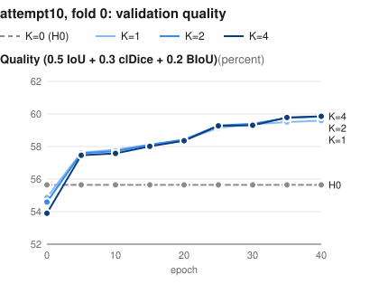
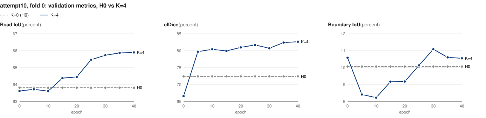
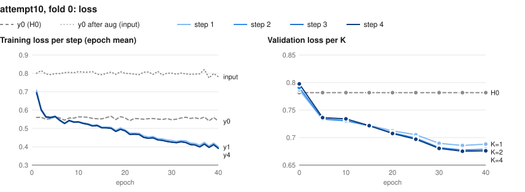
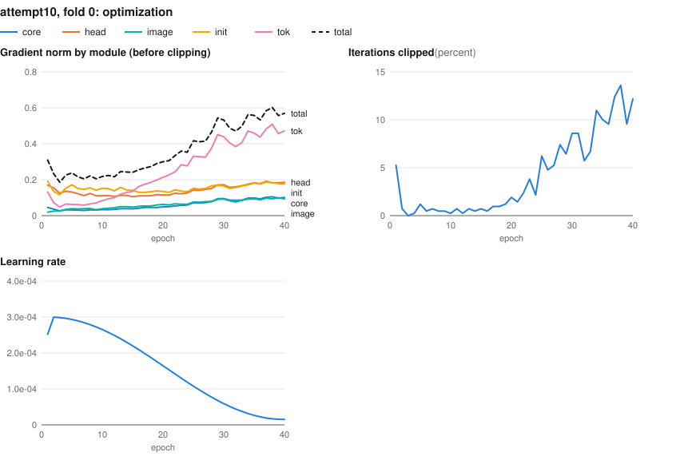
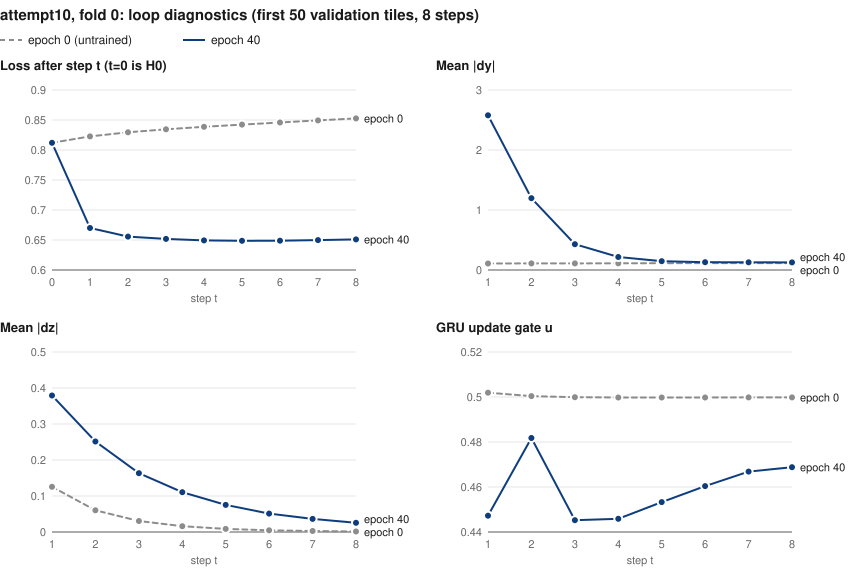

# Training curves: attempt10, fold 0

Made by `project_a/cli/curves.py` from the run's `history.csv`. Validation runs on the whole held-out fold every few epochs (the points); training values are epoch means. Quality = 0.5 IoU + 0.3 clDice + 0.2 Boundary IoU, in percent, counted over all pixels of the fold.

Last validation: epoch 40. Best K=4 quality: epoch 40.

| Epoch 40 | K=0 (H0) | K=1 | K=2 | K=4 |
|---|---|---|---|---|
| Quality | 55.6 | 59.6 | 59.8 | 59.9 |
| IoU | 63.8 | 65.6 | 65.8 | 65.9 |
| clDice | 72.4 | 82.4 | 82.7 | 82.7 |
| Boundary IoU | 10.1 | 10.4 | 10.6 | 10.6 |
| Loss | 0.782 | 0.688 | 0.679 | 0.676 |

## Validation quality

Each K is the same refiner run for K steps. The gap between K=1 and K=4 is what steps 2-4 add.

## Validation metrics

The three parts of quality, H0 against K=4.

## Loss

Left: training loss after each unrolled step, with H0's loss and the loss of the augmented y0 the refiner actually receives. Right: validation loss per K.

## Optimization

Gradient norm per module (epoch mean, before clipping), share of iterations clipped, and the learning-rate schedule.

## Loop diagnostics

Per step t on the first 50 validation tiles, run for 8 steps (past the trained K): loss after step t, mean size of the change to y and to z, and the mean GRU gate. Gray is the first validation (untrained when it is epoch 0), blue the last.

Loop diagnostics at epoch 40:

| Step t | 1 | 2 | 3 | 4 | 5 | 6 | 7 | 8 |
|---|---|---|---|---|---|---|---|---|
| Loss | 0.67 | 0.656 | 0.652 | 0.649 | 0.649 | 0.649 | 0.65 | 0.651 |
| Mean abs dy | 2.578 | 1.196 | 0.43 | 0.217 | 0.147 | 0.13 | 0.128 | 0.127 |
| Mean abs dz | 0.379 | 0.251 | 0.163 | 0.111 | 0.075 | 0.051 | 0.036 | 0.026 |
| Gate u | 0.447 | 0.482 | 0.445 | 0.446 | 0.453 | 0.46 | 0.467 | 0.469 |

Quality on the same 50 tiles:

| K=4 | K=8 | K=4, z reset every step | K=4, y0 fed back instead of y_t |
|---|---|---|---|
| 63.1 | 62.6 | 60.1 | 60.8 |
