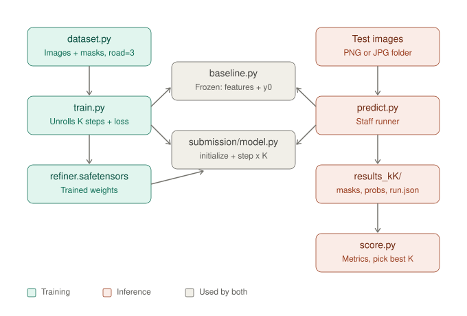

# EC523 Project A: Road Segmentation with a Recurrent Refiner

Inference code for our Project A submission. Given a folder of RGB images, it
predicts a road mask for each one (1 = road, 0 = non-road) at the same height
and width as the input image.




## How it works

1. **Baseline (frozen, staff-provided)**: produces image features and an initial
   road-mask guess `y_0`.
2. **Refiner (ours, `submission/model.py`)**: improves the mask over K rounds.
   Each round:
   - **Tx** turns the baseline features into tokens (with 2D position encoding).
   - **Ty** turns the current mask `y_t` into tokens (probability + uncertainty).
   - **Encoder** fuses the state `z_t` with both token sets.
   - **Core** (one shared transformer, reused every round) updates the state to `z_(t+1)`.
   - **Head** decodes a full-resolution correction: `y_(t+1) = y_t + correction`.
3. `predict.py` (staff runner) saves the mask after exactly K rounds.

## Choosing K

K is the number of refinement rounds. The model never sees K: `predict.py` decides
it with `--steps`, and the same checkpoint works for any K from 0 to 8.

- **K = 0** returns the baseline mask unchanged (no refinement).
- **The official score uses K = 1, 2 and 4**, plus a stress test (corrupted
  images) at K = 4. `score.py` combines these four runs with the leaderboard formula.
- **We train with K = 4 and supervise every round** (the loss is averaged over
  rounds 1 to 4), so the mask is useful after 1, 2 or 4 rounds, not only at the end.
- K = 6 and 8 work too, but were not trained directly; they are reported only in
  the iteration-curve experiment.

## Folder contents

```
predict.py            Inference CLI (staff runner): folder in, masks out
baseline.py           Loads the frozen baseline
common.py             Shared helpers (hashing, output folder checks, JSON)
requirements.txt      Python dependencies
submission/model.py   Our refiner: build_refiner(), initialize(), step()
weights/
  refiner.safetensors   Our trained refiner checkpoint (the only one)
  baseline.safetensors  Frozen baseline checkpoint (staff-provided)
```

## Setup

Python 3.11 is recommended.

```bash
python -m venv .venv
source .venv/bin/activate
pip install -r requirements.txt
```

## Run

From this folder (all paths are relative):

```bash
python predict.py \
  --checkpoint weights/refiner.safetensors \
  --baseline   weights/baseline.safetensors \
  --input      path/to/images \
  --output     results_k4 \
  --steps      4 \
  --device     cuda
```

- `--input`: folder of `.png` / `.jpg` / `.jpeg` images (subfolders are searched).
- `--output`: must be a new or empty folder. We put K in the name (`results_k4`).
- `--steps`: number of refinement rounds K (0 to 8). Graded runs use K = 1, 2 and 4
  (see below); use one output folder per K.
- `--device`: `cuda` or `cpu`.
- `--save-trace` (optional): also saves the mask after every round.

To produce all graded K values, run once per K, each into its own folder:

```bash
for K in 1 2 4; do
  python predict.py \
    --checkpoint weights/refiner.safetensors \
    --baseline   weights/baseline.safetensors \
    --input      path/to/images \
    --output     results_k$K \
    --steps      $K \
    --device     cuda
done
```

Or run K = 4 once with `--save-trace`: `trace/k1`, `trace/k2` and `trace/k4` then hold
the masks after rounds 1, 2 and 4 (the runner never passes K to the model, so a
round-2 mask from a K = 4 run equals the final mask of a K = 2 run).

## Output

```
results_k4/
  masks/<image_id>.png           Final binary mask after K rounds, same H x W as input
  probabilities/<image_id>.npy   Road probability per pixel (float32, 0 to 1)
  trace/k0 ... kK/               Only with --save-trace: mask after each round (k0 = baseline)
  run.json                       Run record: K, seed, device, checkpoint hashes, timing
```

**Which round is which:** the folder name and `run.json` (`"steps"`) give K.
`masks/` and `probabilities/` are always the result after round K.
With `--save-trace`, `trace/k<i>/` is the result after round i.

**Mask values:** `masks/*.png` are written by the staff runner as 0 (non-road)
and 255 (road). To get 0/1, divide by 255, or threshold `probabilities/*.npy` at 0.5.

## Scoring (development data)

`evaluate.py` scores one run (one condition, one K) against a manifest;
`score.py` combines the four graded runs:

```bash
python evaluate.py --manifest <manifest.json> --predictions results_k1 --output reports/ordinary_1.json
python evaluate.py --manifest <manifest.json> --predictions results_k2 --output reports/ordinary_2.json
python evaluate.py --manifest <manifest.json> --predictions results_k4 --output reports/ordinary_4.json

python make_stress.py --manifest <manifest.json> --output stress --seed 0
# run predict.py --steps 4 on the stress images, evaluate with the stress manifest -> reports/stress_4.json

python score.py --ordinary-1 reports/ordinary_1.json --ordinary-2 reports/ordinary_2.json \
  --ordinary-4 reports/ordinary_4.json --stress-4 reports/stress_4.json --output reports/score.json
```

Official manifests come from course staff. For local checks, `make_manifest.py`
builds one from the Val split.

## Hardware

Runs on one GPU (well under 48 GB) or on CPU. Images are processed one at a time
and attention runs on at most a 32x32 token grid, so memory stays small even for
large images.

## Quick check without real data

This uses synthetic images, an untrained model and a fake baseline. It only checks
that the code runs:

```bash
python make_demo.py --output demo
python -c "
from baseline import load_baseline
from submission.model import build_refiner
from safetensors.torch import save_file
base = load_baseline(None, 'cpu', demo=True)
save_file(build_refiner(base.feature_channels).state_dict(), 'demo_ckpt.safetensors')
"
python predict.py --demo --checkpoint demo_ckpt.safetensors --input demo --output demo_out --steps 3
```

Expected output: `Saved N images after exactly 3 steps to demo_out`.

## Data

Course staff supply the data package and official splits. This submission does not
include any data, labels, or our own prediction results.

# EC523 Project A: student materials

- `handout/project_a.tex`: editable LaTeX handout, with vector diagrams,
  equations, bibliography, design choices, and grading expectations.
- `handout/assets/course_imagery.png`: attributed imagery/annotation figure.
- `cli/`: submission runner, untrained example, evaluator, stress generator,
  synthetic demo generator, tests, and usage instructions.

Course staff will supply the versioned data package and official split
manifests. Do not obtain or reconstruct evaluation labels from other sources.
The source credit for the borrowed figure remains in the handout; staff will
provide full research-provenance instructions before any paper submission.

Compile from the `handout` directory:

```sh
latexmk -pdf -interaction=nonstopmode -halt-on-error project_a.tex
```

The bibliography is embedded in the TeX source, so no BibTeX step is needed.
The PDF was built with TeX Live and checked by rendering every page. See
`VALIDATION.md` for the actual checks performed and untested items.

The separate instructor package contains release decisions, data provenance,
and hosting notes. Those notes are not part of the student distribution.

This is a review draft: the trained frozen baseline and final course resource
allocation are intentionally not invented. The source `.tex` and the full
bundle should travel with the PDF so figures and code remain reproducible.
